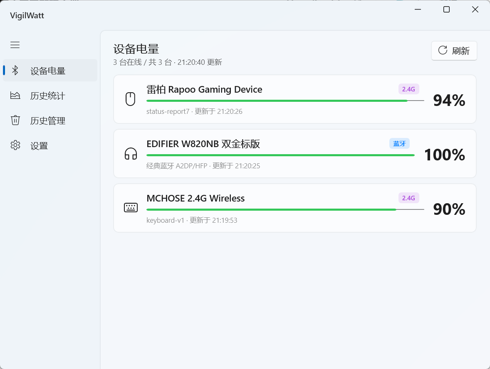
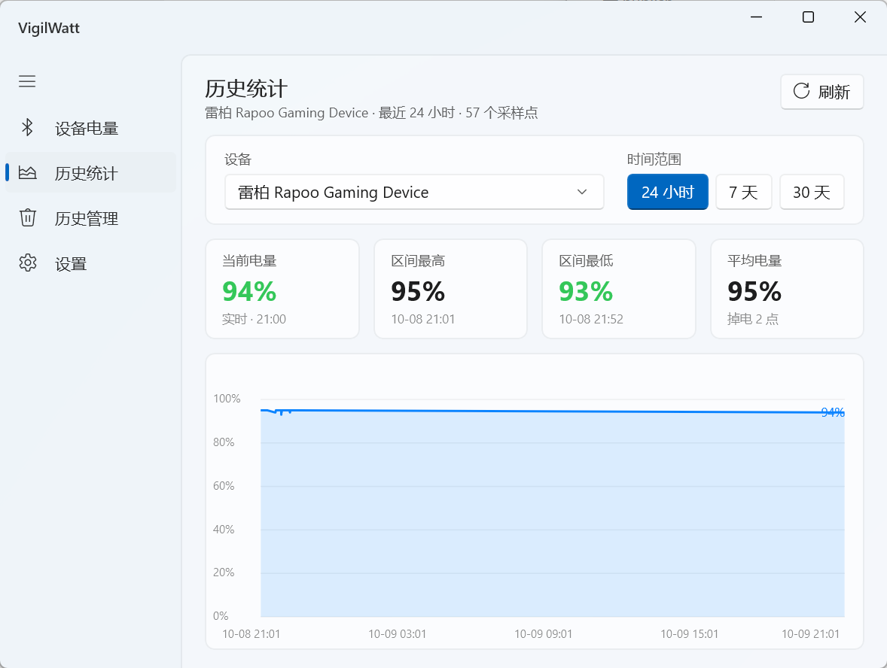
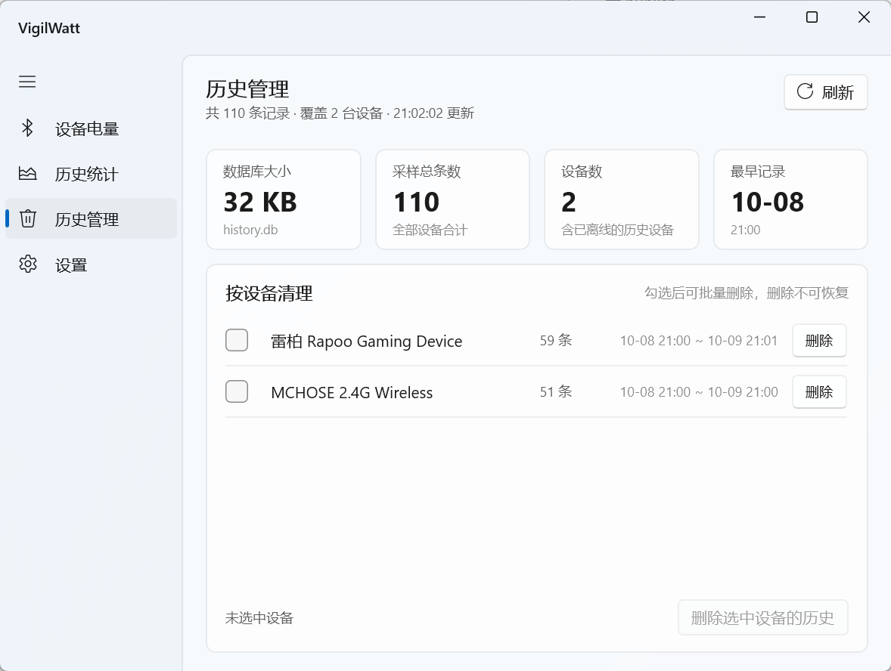
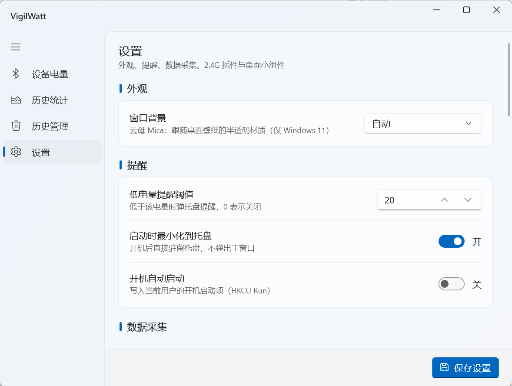

# VigilWatt

> Windows 无线外设电量监控 —— 蓝牙耳机、2.4G 键鼠手柄、笔记本电池，一个托盘图标看全部电量。

   

## 为什么做这个

Windows 看不到 2.4G 鼠标的电量——游戏打得正激烈时突然提示没电，只好手忙脚乱地翻电池、找充电线。这种事发生了几次，于是有了这个项目。

## 界面预览

设备列表、来源徽标与充电标识：



历史统计 · 历史管理 · 设置：

<p align="center">
  
  
  
</p>
<p align="center"><sub>历史统计（24h / 7 天 / 30 天曲线 + 指标摘要卡） · 历史管理（按设备批量删除） · 设置（日志级别 / 本机电量 / 插件开关）</sub></p>

桌面小组件（悬浮电量条，可拖动，不进 Alt-Tab）：

<p align="center"></p>

## 特性

- **蓝牙 & 经典蓝牙**：BLE 直读 GATT Battery Service；经典蓝牙耳机走 HFP 网关节点的 `DEVPKEY_Device_BatteryLevel`（与系统设置页同源）
- **2.4G 私有协议按品牌适配**：迈从 G87、北通 T9、罗技 Bolt、雷柏 VT3、英菲克 ZHEN 已在**本机**实测工作
- **本机电量可选监控**（默认关）：进入设备列表与历史统计；托盘"最低电量"不参与，避免笔记本正常放电染红图标
- **托盘实时显示最低电量** · 低于阈值（默认 20%）弹气泡
- **桌面小组件**：无边框悬浮电量条
- **任务栏电量贴片**（可选，默认关）：在任务栏里直接显示各设备电量（无底框，只留读数），默认贴在托盘左边、可沿任务栏拖动定位
- **历史统计**：SQLite 存储，24h / 7 天 / 30 天曲线 + 指标摘要卡 + 悬停读数
- **历史管理**：按设备批量删除历史 + VACUUM 收缩文件
- **开机自启**：HKCU Run 注册表键

不做：游戏内显示（RTSS/AIDA64）、HTTP 数据接口、主题中心、语音包、账号体系、任务栏 deskband 注入（Win11 已移除该机制）。

## 下载

[Gitee Releases 页面](https://gitee.com/YGWG-LX/vigil-watt/releases) 或本地 `dist/`：

- `VigilWattApp-win-Setup.exe`（44 MB，含 Velopack 自动更新）—— **推荐**
- `VigilWattApp-win-Portable.zip`（37 MB，免安装）

self-contained，**无需安装 .NET 运行时**。`publish/` 目录里另有解压即用的 self-contained 版。

## 快速上手

1. 装好后第一次启动会扫描 2.4G 设备，首次约 6 秒全部到齐
2. 任务栏右下托盘找图标（图标显示当前最低电量百分比，首次可能收在"^"溢出区）
3. 鼠标左键打开主窗口，右键菜单查看全部设备 / 退出
4. 想看笔记本电池：设置页「本机」分节，勾选「监控本机电量」（默认关，避免无电池的台式机出现占位行）

## 支持的设备（本机实测状态）

| 品牌 / 设备 | 通道 | 状态 |
|---|---|---|
| 迈从 G87 键盘 | 2.4G · 0x13 会话协议 | ✅ |
| 迈从新世代 dongle（3837:3033 等） | 2.4G · QHW 协议（M HUB WEB 逆向） | ✅ 已实现，遇即用 |
| 北通 T9 手柄 | 2.4G · 厂商接口被动流 | ✅ 真机验证 |
| 罗技 Bolt 接收器（C548 + MX Master 3S） | HID++ 协议 | ✅ 真机验证 |
| 雷柏 VT3 二代鼠标 | 2.4G · status-report7 被动心跳 | ✅ 真机验证 |
| 英菲克 ZHEN | 2.4G · report 0x03 被动状态帧 | ✅ 真机验证 |
| 经典蓝牙耳机（EDIFIER W820NB 等） | HFP 网关节点 PnP 属性 | ✅ 实测 |
| 本机电池 | `GetSystemPowerStatus` | ✅ 只读、零写入 |

弱水时砂炽天使 2.4G（38FF:0001）已双重确认**无电量通道**（主机侧 + RoseLink 逆向），不在本表。

协议字节级布局、已证伪路径、安全规则 → [docs/hardware/protocols.md](docs/hardware/protocols.md) / [docs/hardware/safety.md](docs/hardware/safety.md)（**写入类改动前必读**）。

## 从源码构建

```bash
# 需要 .NET 8 SDK（8.0.425 实测通过）；务必用 sln 构建
dotnet build VigilWatt.sln -c Debug
src\VigilWatt.App\bin\x64\Debug\net8.0-windows10.0.19041.0\win-x64\VigilWatt.App.exe

# 单测（151 个用例，覆盖帧解析 / 读数过滤 / 经典蓝牙 / 历史库等）
dotnet test src/tests/VigilWatt.Core.Tests

# 发布（仓库根 publish/，self-contained）
dotnet publish src/VigilWatt.App -c Release -p:Platform=x64 -o publish
```

构建坑（XamlCompiler 静默崩溃、双输出路径、Release 需要 `AllowUnsafeBlocks`）→ [docs/dev/build.md](docs/dev/build.md)。

## 项目结构

```
src/
  VigilWatt.Core/         # 无 UI 核心库（BLE / HID / 插件 / 采样 / 存储 / 日志）
  VigilWatt.App/          # WinUI 3 主程序（设备 / 统计 / 历史 / 设置 + 托盘 + 小组件）
  tests/                  # xUnit 单测 + BleScan 诊断小工具
publish/                  # 发布产物（gitignore）
scripts/                  # 临时调试脚本（用完即删）
docs/                     # 完整文档（见 docs/README.md）
assets/                   # README 截图
```

插件架构（`IBatteryPlugin` + `BatteryPluginBase` + 反射发现）：新增品牌 = 加一个类文件。设计细节 → [docs/project/architecture.md](docs/project/architecture.md)。

## 文档

完整文档在 [docs/README.md](docs/README.md)，按「症状速查 / 开发避坑 / 硬件协议 / 审查报告」分门别类。

**最重要的三份**：

- [docs/project/handoff.md](docs/project/handoff.md) — 会话交接快照（新会话 / 新维护者先读）
- [docs/dev/comment-style.md](docs/dev/comment-style.md) — 注释规范：代码里只留 why + docs 指针
- [docs/hardware/safety.md](docs/hardware/safety.md) — 硬件安全规则 + 事故复盘（**写入类改动前必读**）

## 许可证

[MIT](LICENSE) © 2026 evren